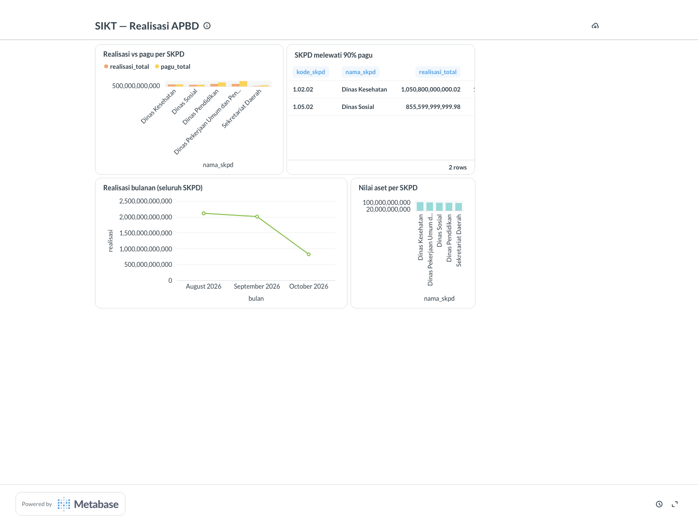

# SIKT Mini Financial Data Lakehouse
[](https://github.com/faishalnuruz/sikt-mini-lakehouse/actions/workflows/ci.yml) [](LICENSE)

Single source of truth untuk APBD: SIMDA MySQL and e-budgeting PostgreSQL captured through real CDC,
landed immutably, transformed by dbt into a tested star schema, orchestrated by Airflow, served in
Metabase, and watched by an alert that fires when an SKPD crosses 90% of its pagu.

This is the local, runnable replication of the SIKT BPKD architecture: every mechanism is real and
every claim below has a command that reproduces it.



## What actually runs

| Layer | Component | Real mechanism |
| --- | --- | --- |
| Sources | SIMDA (MySQL 8.4) | Binary log in ROW format with `binlog_row_metadata=FULL`, streamed by the replication protocol |
| Sources | e-budgeting (PostgreSQL 16) | Logical replication slot with `test_decoding`, drained incrementally |
| Sources | Legacy Oracle Aset | Nightly CSV export — labelled honestly as a file drop, not a live connection |
| Landing | S3-compatible bucket | Versioned, partitioned (`prefix/year=YYYY/month=MM/`), content-addressed keys, boto3 client |
| Warehouse | PostgreSQL `dwh` | Raw layer with a loader manifest and a per-source ingestion heartbeat |
| Transformation | dbt 1.8 | 14 models, 42 tests, source freshness, generated docs |
| Governance | PII + RBAC | SHA-256 hashing at the staging boundary; a BI role with zero grants on the raw schema |
| Orchestration | Airflow 2.10 | 9-task DAG on a 2-hour schedule that matches the freshness SLA |
| Consumption | Metabase | Provisioned entirely through its REST API, with a public dashboard link |
| Alerting | Slack-style payload | Fires for every SKPD over 90% pagu, dry-run by default |

## The one-command story

```bash
docker compose up -d                                  # MySQL + PostgreSQL + S3 + Metabase

python -m sikt.seed_simda && python -m sikt.seed_ebudget
python -m sikt.cdc_mysql --bootstrap                  # 622 events from the real binlog
python -m sikt.cdc_pg                                 # 32 events through the replication slot
python -m sikt.land_references && python -m sikt.land_aset
python -m sikt.loader                                 # manifest-idempotent load

cd dbt && ../.venv/bin/dbt run --profiles-dir .      # 14 models
cd .. && .venv/bin/dbt --version >/dev/null && cd dbt && ../.venv/bin/dbt test --profiles-dir .   # 42 tests

python -m sikt.alert_realisasi                        # who is over 90% pagu?
python -m sikt.metabase_setup                         # dashboard via API
```

## The CDC proof, in numbers

The pipeline was run with a live scenario, not a static dataset:

1. **Initial load**: 592 BKU entries and 5 treasurer records captured from the MySQL binlog (622
   events), 18 pagu rows captured through the PostgreSQL slot (the slot is created before the first
   seed, so even the initial load flows through CDC — the same behaviour as a Debezium snapshot).
2. **A treasurer enters a payment**: `python -m sikt.simulate --new-bku 1.01.02 50000000000` inserts
   one BKU row; the next capture lands exactly that event, and the loader upserts one row.
3. **A mid-year budget revision**: `python -m sikt.simulate --revise-pagu 1.02.02 0.75` updates 4
   pagu rows; the slot carries the UPDATE, dbt rebuilds, and Dinas Kesehatan's realization jumps
   from 71% to **94.67%**.
4. **The alert follows the data**: before the revision one SKPD was over threshold; after CDC
   carried it, two are:

```text
2 SKPD over 90% pagu
  1.02.02  Dinas Kesehatan                               94.67%
  1.05.02  Dinas Sosial                                   93.0%
```

5. **The whole chain is orchestrated**: `airflow dags test sikt_apbd_pipeline` runs 9 tasks —
   capture both sources, land references, load, dbt run, dbt test, freshness gate, alert, Metabase
   sync — and every task finishes `SUCCESS`.

## Governance, tested rather than described

- **PII**: NIKs and bank accounts are hashed (`sha256`) and masked at the staging boundary. A dbt
  test joins staging back to raw and fails if any raw value leaks; a unit test asserts the hash is
  64 hex characters.
- **RBAC**: `analyst_sikt` can read every dbt-built schema and has **zero** tables in `raw` —
  verified by querying `has_schema_privilege`, in a committed integration test.
- **Spending control**: a dbt test fails the pipeline if any SKPD's realization exceeds its pagu.
- **Freshness**: the DAG gates on a per-source ingestion heartbeat, because a rarely-changing table
  must not look stale when the pipeline is healthy — the same SLA reasoning as dbt's source
  freshness, applied to the object that actually represents a pipeline run.

## Tests

```bash
.venv/bin/python -m pytest -q                     # 21 passed (13 unit, 8 integration)
.venv/bin/python -m pytest -m "not integration"  # no stack needed
.venv/bin/ruff check .
```

The integration tests re-run the live flow: a real BKU insert must reach the raw layer, the loader
manifest must make reprocessing a no-op, the PII boundary must hold against the actual database,
the mart must reconcile with the raw ledger after a dbt rebuild, and the landing bucket must have
versioning enabled.

## What is documented rather than simulated

The PRD's production architecture names Debezium, Kafka, MWAA, BigQuery, and OpenMetadata. This
repository is explicit about the difference:

- **Debezium + Kafka** are replaced by direct binlog and replication-slot streaming — the same
  events, without the transport. Swapping the capture modules for Debezium connectors changes two
  files and nothing downstream.
- **MWAA** is plain Airflow here: the DAG, schedule, retries, and SLA gate are the deployable unit.
- **Amazon S3** is LocalStack's S3 API with the exact boto3 client code; the endpoint is the only
  difference.
- **BigQuery/Redshift** is PostgreSQL: the dbt models and star schema port by changing the
  adapter.
- **OpenMetadata** is not built. The PRD's governance row is covered by the PII boundary and RBAC
  here, and by the separate [lakehouse-governance](https://github.com/faishalnuruz/lakehouse-governance)
  project for catalog, lineage, and policy enforcement.

See [`docs/prd-mapping.md`](docs/prd-mapping.md) for the honest, per-requirement mapping —
including which rows of a certain "100% match" table should say *designed*, not *done*.

## Repository map

```text
compose.yaml          MySQL + PostgreSQL + LocalStack S3 + Metabase
src/sikt/             seeds, CDC captures, loader, freshness, alert, Metabase provisioning
dbt/                  dbt project: staging → intermediate → marts, 42 tests, docs
dags/                 the Airflow DAG
tests/                13 unit tests (no stack) + 8 integration tests (stack running)
tools/                the CDP screenshot utility used for the dashboard image
docs/                 architecture, evidence, the PRD mapping, generated dbt docs
```

## Local credentials

Every password in `compose.yaml` and `src/sikt/config.py` is a local demo value, committed openly
because none of them protects anything. The Metabase admin is `admin@sikt.local` / `sikt-admin-2026`.
If any of these strings ever appear in a real environment, that environment is misconfigured.
